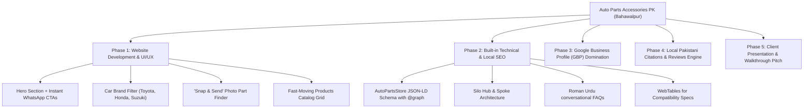

# 🚗 AUTO PARTS ACCESSORIES PK - BAHAWALPUR
## 🎯 Complete Project Architecture, Website Blueprint & SEO Execution Roadmap

---

### 📌 Project Executive Summary
* **Business Name:** Auto Parts Accessories PK
* **Location:** Bahawalpur, Punjab, Pakistan
* **Business Model:** Physical Auto Spare Parts Shop + Digital Catalog & Local Lead Generation
* **Primary Conversion Goal:** Direct WhatsApp Inquiries, Direct Phone Calls, Shop Walk-in Visits
* **SEO Objective:** #1 Organic Search & Google Maps (Local 3-Pack) in Bahawalpur & Surrounding Areas

---



---

## 🛠️ 1. TECH STACK & DESIGN SYSTEM

### A. Tech Stack
* **Core:** Modern High-Performance Web Architecture (SSR/SSG Fast Static Engine)
* **Styling:** Custom Vanilla CSS (Automotive Racing Dark Theme, Grid & Flexbox, Hardware-accelerated transitions)
* **Assets:** WebP Format (<80KB per image), Vector SVGs, Clean Transparent Product Shots
* **Tracking:** Google Analytics 4 (GA4) + Google Tag Manager + Microsoft Clarity (Heatmaps)

---

### B. Curated Color Palette (Automotive Racing Vibe)
* 🔴 **Primary Racing Red (`#D31826` / `#C81E27`):**
  * CTA buttons (*"WhatsApp Par Part Mangwayen"*, *"Call Now"*), active filter tabs, pricing badges, urgent alerts, aur key highlights.
* 🌑 **Aggressive Dark (`#0F1115` / `#16191E`):**
  * Hero section backdrop, navbar header background, dark-mode automotive panels, aur high-end glassmorphism cards.
* 🔘 **Cool Metallic Grey (`#858B94`):**
  * Secondary body text, subtle card borders, technical part specifications, aur car brand outline icons.
* ⚪ **Pure Clean White (`#FFFFFF` / `#F8FAFC`):**
  * High-contrast headings, main content text, readable light cards, aur clean product background canvases.
* 🟢 **WhatsApp Brand Green (`#25D366`):**
  * Floating WhatsApp button, direct WhatsApp triggers, aur verified availability tags.

---

### C. Typography & Stylistic Vibe
* **Heading Font:** `Rajdhani` / `Chakra Petch` / `Montserrat` *(Extra Bold Italic)*
  * Gives the slanted, high-speed, precision racing look that matches the shop's logo branding.
* **Body Font:** `Plus Jakarta Sans` / `Inter` *(Regular, Medium & SemiBold)*
  * Maximum readability on mobile screens for part numbers, car compatibility specs, and addresses.

---

### D. Logo Elements Embedded into UI (Signature Micro-Interactions)
1. **The Speed-Lines (Divider Accent):**
   * Logo mein `ACCESSORIES PK` ke dono sides par mojood horizontal speed-streaks ko har section heading ke neeche custom CSS gradient divider line ke tor par use kiya gaya hai.
2. **The Red Gear Micro-Interaction:**
   * Logo ke 'O' ke andar jo red gear hai, usko button hover effects, loading spinners, aur category card active micro-animations ke liye dynamic CSS rotation element banaya gaya hai.

---

## 🌐 2. WEBSITE STRUCTURE & URL SILO ARCHITECTURE

Hum proper **Hub & Spoke Silo Structure** implement karenge taake keyword cannibalization na ho aur PageRank authority smoothly flow kare.

```
├── / (Homepage - Main Bahawalpur Pillar Hub)
│
├── /brands/
│   ├── /brands/toyota-parts-bahawalpur
│   ├── /brands/honda-parts-bahawalpur
│   └── /brands/suzuki-parts-bahawalpur
│
├── /categories/
│   ├── /categories/brake-pads-discs
│   ├── /categories/suspension-shock-absorbers
│   ├── /categories/engine-transmission-parts
│   └── /categories/filters-lubricants
│
├── /part-finder (Snap & Send Part Request via WhatsApp)
│
├── /areas-served/ (Surrounding Tehsils Delivery Hub)
│   ├── /areas-served/ahmedpur-east
│   ├── /areas-served/yazman
│   └── /areas-served/lodhran
│
└── /shop-location (Address, Timings, Live Google Map, Counter Photos)
```

---

## 📄 3. PAGE-BY-PAGE WIREFRAME & SECTIONS

### 🏠 A. Homepage Wireframe (High-Converting Conversion Engine)
1. **Top Bar:** 
   * 📍 Shop Address: Bahawalpur | ⏰ Timings: 9:00 AM - 9:00 PM | 📞 Call: +92 3XX-XXXXXXX
2. **Navbar:** 
   * Logo (`Auto Parts Accessories PK`), Brand Selector Dropdown, Categories Dropdown, "Find Part", [WhatsApp Inquire] (Red CTA Button).
3. **Hero Section (First Viewport Magic):**
   * **Badge:** 📍 *#1 Trusted Genuine Auto Spare Parts in Bahawalpur*
   * **H1 Title:** *Your Car, Our Parts, Your Performance.*
   * **Subtitle:** *Bahawalpur mein Toyota, Honda, Suzuki aur tamam Japanese gariyon ke 100% genuine auto parts aur direct counter delivery.*
   * **Dual Action CTAs:**
     * `[ 🟢 WhatsApp Par Part Mangwayen ]` (Direct WhatsApp link with pre-filled text)
     * `[ 📞 Direct Call Store ]`
4. **Quick Vehicle Selector (Make & Model Filter):**
   * Visual Grid of top Pakistani Car Logos: **Toyota**, **Honda**, **Suzuki**, **Hyundai**, **Kia**, **Daihatsu**, **Changan**.
   * Click karne par specific brand parts filter ho jayein.
5. **"Snap & Send" Part Finder (The Showstopper Hero Feature):**
   * *Headline:* "Part ka exact naam ya number nahi pata?"
   * *3-Step Visual Process:*
     1. 📸 Purane/Toote hue part ki picture kheenchain.
     2. 💬 WhatsApp button par click karke picture send karein.
     3. ⏱️ 5 minute ke andar availability aur best wholesale rate payen.
   * *Big Button:* `[ 📸 Part Ki Picture WhatsApp Karein ]`
6. **Popular Categories Grid (Visual Icons with Gear Micro-Animations):**
   * 🛑 Brakes & Hubs (Brake Pads, Discs, Calipers)
   * 🏎️ Suspension & Steering (Shocks, Bushings, Arms)
   * ⚙️ Engine & Transmission (Spark Plugs, Belts, Mounts)
   * 🛢️ Filters & Oils (Oil Filters, Air Filters, Cabin Filters)
   * 💡 Body & Lights (Headlights, Bumpers, Side Mirrors)
7. **Fast-Moving Stock Showcase:**
   * High-demand parts grid (Alto Brake Pads, Civic Shocks, Corolla Oil Filter, Mehran Clutch Plate).
   * Har card par button: `[ 💬 WhatsApp Inquiry ]` (Pre-filled: *"Hi, mujhe [Part Name] ka rate aur availability chahiye"*).
8. **Trust Badges & E-E-A-T Proof:**
   * 🛡️ 100% Genuine Guaranteed (No Counterfeit/Do Number Parts)
   * ⚡ Instant Bahawalpur Counter Pickup
   * 🚚 Same-Day Surrounding Delivery (Ahmedpur, Yazman, Lodhran)
   * 🔧 Free Technical Guidance (Model Compatibility Check)
9. **Physical Store & Location Showcase (Local SEO Core):**
   * 3 Real HD Shop Photos (Front board, Counter, Stock Inventory).
   * Embedded Google Map with direct Customer Place ID (CID).
   * Button: `[ 📍 Get Directions on Google Maps ]`
10. **Roman Urdu FAQ Section (AI Overviews & Transliteration Search):**
    * Frequently asked questions in English & Roman Urdu with clean accordion.
11. **Footer:**
    * Full NAP (Name, Address, Phone), Business Timings, Quick Brand Links, Copyright.
12. **Sticky Mobile Action Bar:**
    * Fixed bottom bar on Mobile: `[ 📞 Call Now ]` & `[ 🟢 WhatsApp Chat ]`.

---

## ⚡ 4. BUILT-IN TECHNICAL & LOCAL SEO ARCHITECTURE (CODE LEVEL)

### 1. Unified JSON-LD Schema (`@graph` Architecture)
Ek hi `<script type="application/ld+json">` mein sabhi entities ko bind karenge:
* `AutoPartsStore` (Shop Name, Logo, URL, Telephone, Opening Hours)
* `PostalAddress` (Bahawalpur, Punjab, Postal Code, PK)
* `GeoCoordinates` (Exact Latitude & Longitude)
* `areaServed` (Bahawalpur, Ahmedpur East, Yazman, Lodhran)
* `hasOfferCatalog` / `Product`
* `sameAs` (External authoritative links: Facebook, PakWheels, Google Maps CID)

### 2. High-Performance Core Web Vitals Standard
* **TTFB (Time to First Byte):** < 150ms via CDN Edge Caching.
* **LCP (Largest Contentful Paint):** < 2.0s (Hero banner preloaded with `<link rel="preload">`).
* **CLS (Cumulative Layout Shift):** Strictly `0.00` (All images explicit `width` & `height` attributes).
* **Two-Wave Indexing Safe:** 100% critical content, titles, schemas Server-Side Rendered (SSR/SSG).

### 3. OpenGraph WhatsApp Rich Sharing Cards
Jab shop ka link kisi customer ya auto group mein share hoga:
* `og:title`: *Auto Parts Accessories PK | Genuine Car Parts in Bahawalpur*
* `og:description`: *Toyota, Honda, Suzuki ke 100% genuine spare parts. WhatsApp par part photo send karein aur rate hasil karein.*
* `og:image`: High-res branded preview banner (1200x630px).

---

## 📅 5. PHASE-BY-PHASE EXECUTION ROADMAP

| Phase | Milestone | Deliverables / Actions |
| :--- | :--- | :--- |
| **Phase 1** | **Website Development** | • Modern UI/UX layout with Racing Red & Dark Charcoal palette<br>• Speed-Lines Dividers & Gear Micro-Animations<br>• Responsive Mobile-First Homepage<br>• Vehicle Filter & "Snap & Send" Part Finder<br>• Direct WhatsApp Smart Integration & GA4 Events |
| **Phase 2** | **Technical & On-Page SEO** | • SSR/SSG setup with Flat Clean URLs<br>• JSON-LD `@graph` AutoPartsStore Schema<br>• WebTables for Parts Specs & Roman Urdu FAQs<br>• XML Sitemap (ISO 8601 `<lastmod>`) & robots.txt |
| **Phase 3** | **Google Business Profile (GBP)** | • Category: *Auto Parts Store* + Secondary: *Car Accessories*<br>• Exact NAP Matching with Website<br>• Geo-tagged Shop & Inventory Photos<br>• Top 10 Fast-Moving Products uploaded to GBP |
| **Phase 4** | **Citations & Review Engine** | • Pakistani Citations (PakWheels, OLX, Bolee, FB Local)<br>• Counter QR Code Standee ("Scan to WhatsApp & Review")<br>• Review generation script with localized keywords |
| **Phase 5** | **Live Pitch & Client Presentation** | • Live interactive demo to client<br>• Demonstrating real WhatsApp leads & Speed score (95+)<br>• Handover of printable counter QR Standee |

---

## 🚀 IMMEDIATE ACTION: PHASE 1 DEVELOPMENT
Ab hum **Phase 1: Website Development** shuru kar rahe hain. Har component ko is exact styling aur high-converting branding ke sath code kiya jayega!
